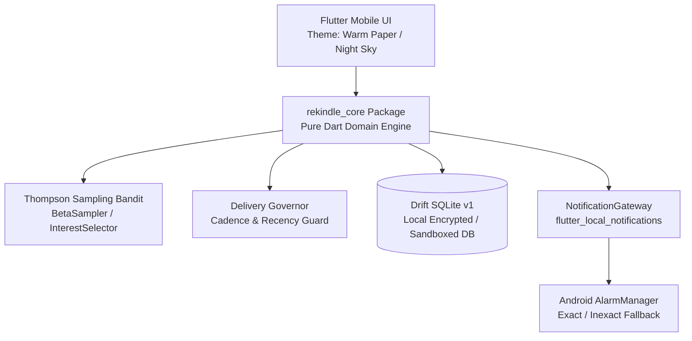
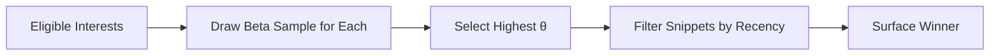
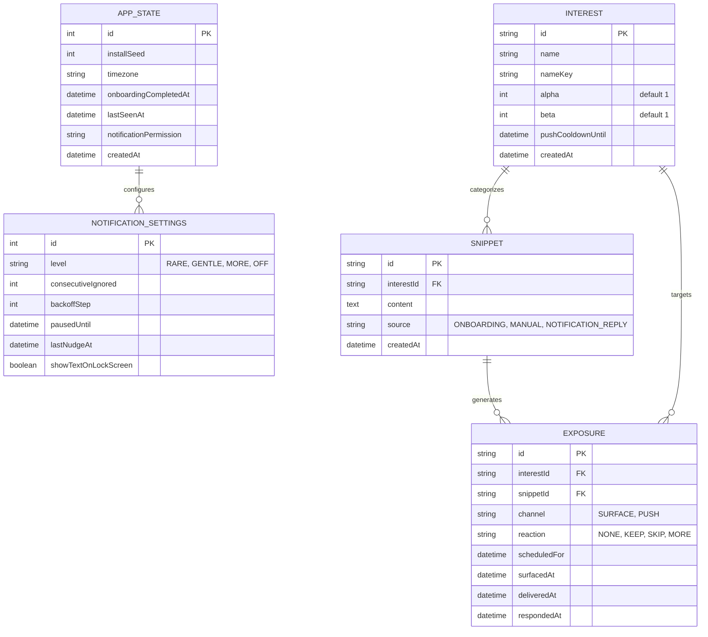
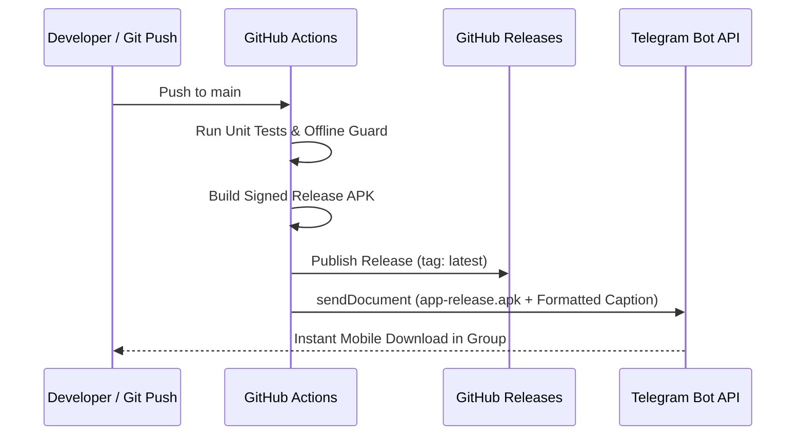
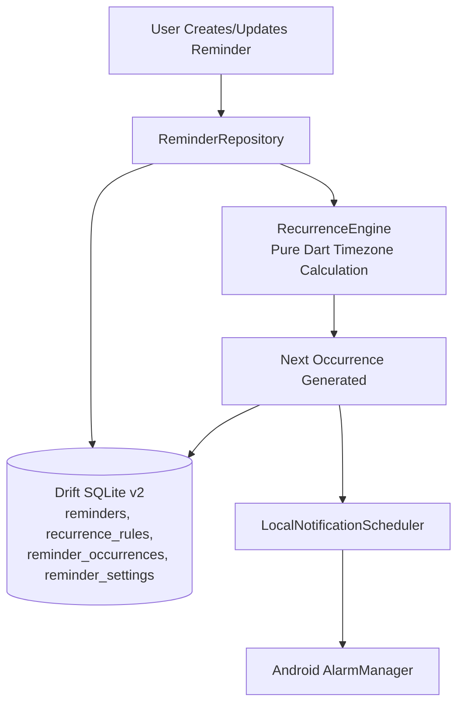

# Rekindle — Architecture Document (v0.2)

## 1. Vision & Purpose

Rekindle is **not** a spaced-repetition tool or a study flashcard app. It does not ask *"what are you overdue to review?"*

Instead, it asks: **"what would you enjoy rediscovering right now?"**

When the user has an idle moment, Rekindle quietly surfaces one thought, note, or quote saved in the past. There are no streaks, no due dates, no guilt mechanics, and no pressure.

Rekindle is built as a **100% offline, private-by-design, on-device Flutter mobile application**. There are zero server calls, zero tracking SDKs, and zero network permissions in the app binary.

---

## 2. System Architecture

### Architectural Principles:
1. **Zero Network Footprint**: The application does not declare `android.permission.INTERNET`. All intelligence, scheduling, sampling, and storage run entirely on the user's phone.
2. **Decoupled Engine (`packages/rekindle_core`)**: All business logic (bandit algorithms, database tables, scheduling planners, delivery governor) is decoupled into a standalone pure-Dart package with 100% unit test coverage.
3. **Calm Design System**: Warm paper light mode (`#F8F6F0`) and deep ink dark mode (`#121316`), Lora serif headlines, and tactile interaction design.
4. **Deterministic & Resilient Scheduling**: 72-hour planning horizons with graceful degradation across all Android versions (Android 8 to 15+).

---

## 3. Core Domain Concepts

| Concept | Description |
|---|---|
| **Interest** | A topic the user cares about (e.g. *Databases*, *Philosophy*, *Photography*). Operates as an **arm** of the multi-armed bandit. |
| **Snippet** | A specific saved nugget tied to an interest — an insight, question, memory, or quote. |
| **Exposure** | An immutable audit log entry of when a snippet or capture prompt was surfaced, its delivery channel (`SURFACE` or `PUSH`), and the user's reaction. |
| **Alpha ($\alpha$) & Beta ($\beta$)** | Bayesian prior parameters per interest. $\alpha$ counts positive engagements (`keep`, `tell me more`), $\beta$ counts skips (`skip`). |
| **Delivery Governor** | Enforces anti-nagging rules: minimum gaps between nudges (6 hours), daily caps per level, and exponential backoff after consecutive ignores. |

---

## 4. On-Device Suggestion Engine — Thompson Sampling

Rekindle selects interests using **Beta-Bernoulli Thompson Sampling**:

$$\theta_i \sim \text{Beta}(\alpha_i, \beta_i)$$

$$\text{winner} = \arg\max_i \theta_i$$

1. **Eligibility Check**: Only interests that have at least one snippet are eligible to surface on the main canvas.
2. **Prior Initialization**: New interests begin with $\alpha = 1, \beta = 1$ (uniform distribution), naturally balancing exploration of new topics with exploitation of beloved ones.
3. **Recency Suppression**: Snippets surfaced recently (or pushed within 24 hours) are temporarily suppressed so the user never sees repetitive content.
4. **Learning Update**:
   - `keep` or `more` $\rightarrow \alpha \leftarrow \alpha + 1$
   - `skip` $\rightarrow \beta \leftarrow \beta + 1$

---

## 5. Local Data Model (Drift SQLite Schema v1)

---

## 6. Android Notification & Background Architecture

Android notification delivery is designed to be **version-agnostic and crash-proof**:

1. **Exact-to-Inexact Alarm Degradation**:
   - Tries `AndroidScheduleMode.exactAllowWhileIdle`.
   - If Android 13/14+ throws `ExactAlarmPermissionException` or `SecurityException`, it immediately catches it and falls back to `AndroidScheduleMode.inexactAllowWhileIdle`.
2. **Component Registration**:
   - `ScheduledNotificationReceiver`: Handles firing `AlarmManager` intents.
   - `ScheduledNotificationBootReceiver`: Automatically restores scheduled nudges upon phone reboot (`BOOT_COMPLETED`, `MY_PACKAGE_REPLACED`).
   - `ActionBroadcastReceiver`: Processes inline action clicks (`Keep`, `Skip`, `Tell me more`).
3. **R8 / ProGuard Keep Rules**:
   - `-keepattributes Signature, InnerClasses, *Annotation*` preserves generic type information for Gson's `TypeToken` serialization, preventing release-mode runtime crashes.

---

## 7. CI/CD & Automated Sideload Distribution

---

## 8. Offline Reminder Scheduling Architecture

The reminder system is an independent, 100% offline subsystem that allows users to attach intentional, recurring or one-time revisit reminders to thoughts or activities.

### Architectural Boundaries & Rules:
1. **Decoupled from Recommendation Engine**: Thompson Sampling recommendations never automatically schedule reminders; only deliberate user actions create or edit reminders.
2. **Local DB as Single Source of Truth**: Android notification alarms are derived representations. If the OS drops an alarm or the device reboots, local reconciliation restores alarms from the database.
3. **Single Next Occurrence**: Only the immediate next occurrence is computed and scheduled. Once delivered or completed, the next occurrence is calculated and enqueued.
4. **Timezone Awareness & DST Resilience**:
   - `IntervalRule` evaluates elapsed wall time ($\Delta t$).
   - `WeeklyRule` evaluates local calendar weekdays and wall-clock time in the configured IANA timezone location using the `timezone` package.
   - Ambiguous or skipped DST transitions gracefully resolve to the nearest valid local instant.
